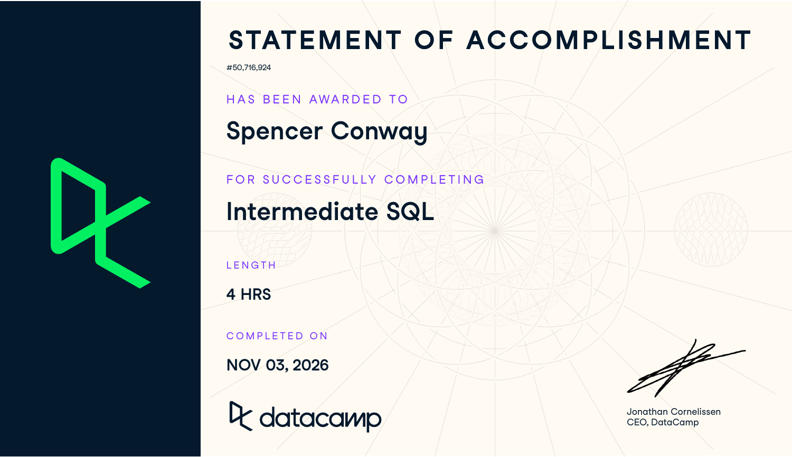

**Course:** IBM 6500  
**Program:** Master of Science in Digital Marketing, Cal Poly Pomona

# Course-Completion Evidence

My certificate for **Intermediate SQL** is below. DataCamp lists the completion date as **November 3, 2026**.

{fig-alt="Spencer Conway's Intermediate SQL certificate, completed November 3, 2026."}

[View the DataCamp statement of accomplishment](https://www.datacamp.com/completed/statement-of-accomplishment/course/5b21e0cf326285c860e0eb29e89eb081bc264348).

# Learning Notes and Key Takeaways

These notes cover the four chapters from the course. The examples use PostgreSQL and the DataCamp films database. The `films` table has movie information, `people` has names and dates, and `reviews` has ratings and social media numbers. The RKR examples are ways I could use SQL once we get our data.

## Selecting Data

### Main ideas

This chapter covered **Querying a database**, **Query execution**, and **SQL style**. The main idea is choosing what data to pull from a table. `SELECT` chooses the columns and `FROM` tells SQL which table to use. `COUNT()` counts values, and `DISTINCT` removes repeats.

SQL does not run everything in the order we write it. For a basic query, it starts with `FROM`, then `SELECT`, then `LIMIT`. This helps explain why the table has to be identified first.

### Important SQL syntax

- `SELECT field FROM table;` selects a column.
- `COUNT(*)` counts every row.
- `COUNT(field)` counts values that are not missing.
- `COUNT(DISTINCT field)` counts unique values and leaves out nulls.
- `AS` gives a column a name in the results.
- `LIMIT 10` shows only ten rows. I would add `ORDER BY` if I needed a specific order.

### When to use it

I would use these commands when first opening a dataset. They help check the number of rows and what information is there before doing more analysis.

### SQL example and explanation

```sql
SELECT COUNT(*) AS count_records,
       COUNT(birthdate) AS count_birthdate
FROM people;
```

This gives two counts in one row. There are **8,397 people records**, but only **6,152 have a birthdate**. `COUNT(*)` includes all rows, while `COUNT(birthdate)` skips missing birthdates.

```sql
SELECT COUNT(DISTINCT country) AS count_distinct_countries
FROM films;
```

This counts the unique countries in the films table. The answer was **64**. Without `DISTINCT`, the same country would get counted again for each film.

The chapter also covered basic formatting, like capitalizing keywords and putting clauses on separate lines. Spelling and commas matter too. A small typo can stop the query from running. If a column name has a space, PostgreSQL needs double quotes around it, like `"facebook likes"`.

### CEP application

For RKR, I could count how many Instagram posts we have and check which formats are included. I could also check whether any posts are missing reach or engagement numbers.

## Filtering Records

### Main ideas

This chapter covered **Filtering numbers**, **Multiple criteria**, **Filtering text**, and **NULL values**. `WHERE` lets us narrow down the data. With `AND`, both conditions have to be true. With `OR`, only one has to be true. Parentheses help keep those conditions together correctly.

`BETWEEN` includes the start and end of a range. `IN` checks a list of values, and `LIKE` searches for a text pattern. `NULL` means the value is missing or unknown. We use `IS NULL` to find those values, not `= NULL`.

### Important SQL syntax

- Comparisons: `=`, `<>`, `>`, `<`, `>=`, and `<=`.
- Ranges: `WHERE release_year BETWEEN 1990 AND 1999`.
- Lists: `WHERE language IN ('English', 'Spanish')`.
- Patterns: `LIKE 'B%'` matches text beginning with B; `LIKE '_r%'` matches text with r in the second position.
- Exclusions: `NOT LIKE 'A%'` excludes matching names.
- Missing values: `WHERE budget IS NULL` or `WHERE budget IS NOT NULL`.

### When to use it

I would use filtering when I only need part of a dataset, like one year or one language. It can also leave out missing information. With `LIKE`, capitalization matters in PostgreSQL.

### SQL example and explanation

```sql
SELECT COUNT(DISTINCT title) AS nineties_english_films_for_teens
FROM films
WHERE release_year BETWEEN 1990 AND 1999
  AND language = 'English'
  AND certification IN ('G', 'PG', 'PG-13');
```

This counts unique movie titles from 1990 through 1999 that are in English and rated G, PG, or PG-13. All three conditions have to match. The result was **310**. It counts titles, so it is not quite the same as counting film IDs.

```sql
SELECT title AS no_budget_info
FROM films
WHERE budget IS NULL;
```

This lists titles with missing budgets. A missing budget does not mean the budget was zero.

### CEP application

For my Instagram analysis, I could look at posts from the same dates or filter for just Reels. If we get promotion information, I could also separate paid and organic posts. We still need to see which fields RKR can send us.

## Aggregate Functions

### Main ideas

This chapter covered **Summarizing data**, **Summarizing subsets**, and **Aliasing and arithmetic**. Aggregate functions give a summary of several rows. The main ones are `COUNT()`, `SUM()`, `AVG()`, `MIN()`, and `MAX()`.

`SUM()` and `AVG()` need numbers. `MIN()`, `MAX()`, and `COUNT()` can also work with dates or text. These functions generally skip missing values. For example, `AVG()` does not turn a missing value into zero.

Arithmetic works within a row, like subtracting a movie budget from its earnings. Aggregation works across rows, like adding all budgets together. One detail to remember is that dividing two integers in PostgreSQL drops the decimal part. Using `60.0` instead of `60` avoids that problem when converting minutes to hours.

### Important SQL syntax

- `SUM(duration)` calculates a total.
- `AVG(duration)` calculates an average of nonmissing durations.
- `MIN(duration)` and `MAX(duration)` find the smallest and largest durations.
- `ROUND(value, 2)` rounds to two decimal places; `ROUND(value, -3)` rounds to the nearest thousand.
- `duration / 60.0 AS duration_hours` converts minutes to hours.
- `WHERE` filters individual records before the aggregation takes place.

### When to use it

These functions are useful when I need a total or average instead of every row. I can also add `WHERE` to summarize only certain records. `ROUND()` makes long decimal results easier to read.

### SQL example and explanation

```sql
SELECT ROUND(AVG(facebook_likes), 1) AS avg_facebook_likes
FROM reviews;
```

This finds the average Facebook likes and rounds it to one decimal place. The result was **7,802.9** for the course data. I would not use that number as an RKR benchmark because it comes from a different dataset.

```sql
SELECT title,
       ROUND(duration / 60.0, 2) AS duration_hours
FROM films;
```

This shows each movie title and its length in hours. Dividing by `60.0` keeps the decimals, and `ROUND()` rounds to two places. `duration_hours` makes it clear what the new column means.

### CEP application

For RKR, I could find average likes, comments, shares, or saves. An average is different from an engagement rate, though. For a rate, I would need to decide what to divide by, like reach, and check for zero or missing values. The course also showed why units matter. Its movie budgets are in different currencies, so the raw numbers are not directly comparable.

## Sorting and Grouping

### Main ideas

This chapter covered **Sorting results**, **Grouping data**, and **Filtering grouped data**. `ORDER BY` sorts from smallest to largest by default, or alphabetically for text. `DESC` reverses that. If there are two sort columns, the second one sorts records that tie on the first.

`GROUP BY` lets us calculate results for each group instead of the whole table. Columns in `SELECT` usually need to be grouped or included in an aggregate function. `WHERE` filters rows before grouping, and `HAVING` filters the groups afterward. The execution order is `FROM`, `WHERE`, `GROUP BY`, `HAVING`, `SELECT`, `ORDER BY`, then `LIMIT`.

### Important SQL syntax

- `ORDER BY duration DESC` puts larger durations first.
- `GROUP BY release_year` produces summaries for each release year.
- `GROUP BY release_year, country` produces a summary for each combination.
- `HAVING AVG(budget) > 60000000` keeps only groups meeting the aggregate condition.
- An alias from `SELECT` can be used in `ORDER BY`. In PostgreSQL, it cannot be used in `WHERE` or `HAVING` in the same query.

### When to use it

I would use grouping to compare categories or years. Sorting would then help show the highest or lowest results. `HAVING` could keep only groups that meet a requirement, like having enough records to compare.

### SQL example and explanation

```sql
SELECT release_year,
       COUNT(DISTINCT language) AS language_count
FROM films
GROUP BY release_year
ORDER BY language_count DESC
LIMIT 5;
```

This counts unique languages for each release year and shows the top five years. **2006 had 16 languages**, which was the most. `GROUP BY` is what makes the count separate for each year.

```sql
SELECT release_year,
       AVG(budget) AS avg_budget,
       AVG(gross) AS avg_gross
FROM films
WHERE release_year > 1990
GROUP BY release_year
HAVING AVG(budget) > 60000000
ORDER BY avg_gross DESC
LIMIT 1;
```

This query puts several parts of the course together. It starts with films after 1990 and finds average budget and earnings for each year. It keeps years with average budgets above 60 million, sorts by average earnings, and returns the top year. Since the budgets use different currencies, this is mainly an example of how to build the query.

### CEP application

This would be useful for my Instagram objective. I could group posts by format and compare their average engagement. I would also count the posts in each group so I know if an average is based on only a few posts. This could show which formats did better, but it would not prove that a format caused more reservations.

# Overall Reflection and Series Synthesis

**Which intermediate SQL concepts or query patterns were most useful?**

I think `WHERE`, `GROUP BY`, and `AVG()` would be the most useful together. They would let me choose the data I need and compare groups without having to look through every row.

**Which concepts were most challenging, and how did you resolve your confusion?**

The part that needs the most review is the difference between `WHERE` and `HAVING`. The examples help show that `WHERE` is for rows and `HAVING` is for groups. Keeping the execution order in my notes gives me something to check when deciding which one to use.

**How did this course extend what you learned in Introduction to SQL?**

Introduction to SQL was more about tables and basic queries. This course goes further by showing how to filter, calculate, sort, and group the results. It also covers missing values and fixing errors.

**How might you apply these skills in BigQuery?**

I could use these same ideas when working with marketing data in BigQuery. I would still need to check the syntax, like using backticks around full table paths. GA4 data can also have nested fields, so there would be more to learn before using it.

**How could these skills support digital marketing analytics, customer insights, survey research, GA4 analysis, or your CEP?**

These skills could help compare Instagram formats, count survey responses, or summarize website activity. For RKR, we still need to get the data first. I can only answer questions that the available information supports, especially when it comes to reservations.

**Which sections of your completed portfolio do you expect to consult again?**

I would go back to the first report for basic SQL and the BigQuery report for reminders about that platform. In this report, I would probably use the filtering and grouping sections the most. I would also check the notes on null values and division when a result looks wrong.

# Appendix: Publication Links

- [GitHub Repository](https://github.com/spencerconway0/ibm-6500-sql-learning-portfolio)
- [Published Intermediate SQL Report](https://spencerconway0.github.io/ibm-6500-sql-learning-portfolio/intermediate-sql.html)
- [Published Portfolio Landing Page](https://spencerconway0.github.io/ibm-6500-sql-learning-portfolio/index.html)
